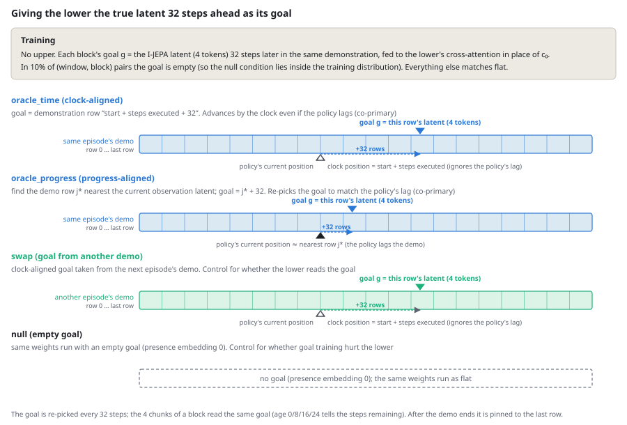
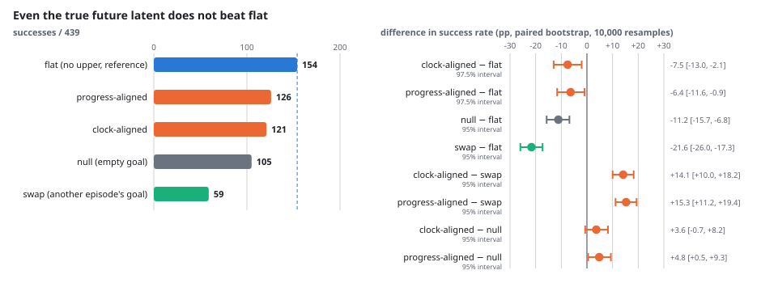
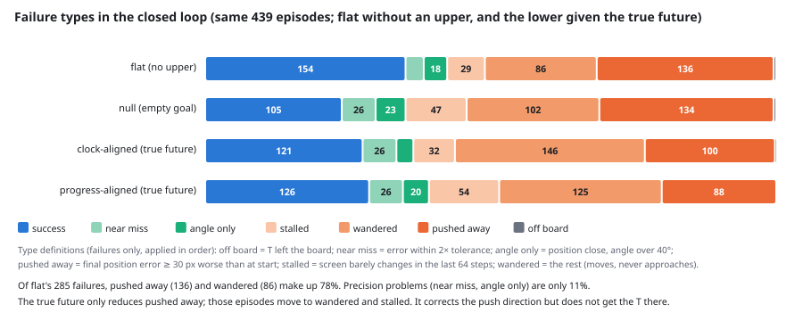
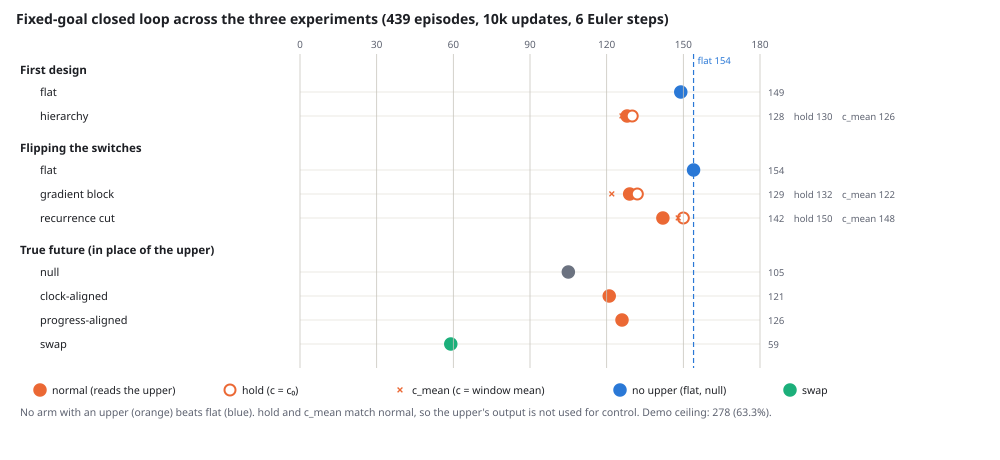

## What I tried

In the [first post](../pusht-hierarchy-upper-unread/), a hierarchy with no loss on the upper level was ignored by the lower level, and flipping the suspect switches one at a time only removed the harm without beating flat. The question left open was whether "the upper is trained the wrong way" or "Push-T simply has no information for an upper to add".

To tell these apart, I removed the upper's training altogether and handed the lower the best output an upper could possibly produce, to measure the ceiling. As each block's goal, the lower receives the true latent 32 steps later in the same demonstration. If this beats flat, a perfect upper would have headroom, and the next step is to train the upper as a predictor of future latents. If it does not, I conclude that Push-T leaves no gap for an upper to fill and move the hierarchy research to a different task. This branch was pre-registered before the run.

The result: it did not beat flat. The lower given the true future falls 6 to 8 pp below flat. This is not because the lower ignores the goal: handing it a goal from a different episode drops success by 14 to 15 pp, so it reads the goal strongly, and still loses in the closed loop. Looking at the failure types, 80% are not precision problems but "mis-push and drift away": even with the right intermediate goal, the lower cannot get there.

## Setup

The model and evaluation are the same as in the [first post](../pusht-hierarchy-upper-unread/).

- **Lower**: a flow-matching predictor that outputs the next 8 steps at once from the last 8 observations. Width 1,280, 8 layers, 330M parameters, with cross-attention to one memory token in every layer
- **flat**: no upper; reads a learned constant c₀ as its memory token
- **Evaluation**: fixed-goal closed loop over 439 episodes. Budget 300 steps; success if the T reaches (256, 256, 45°) within 20 px in position and 20° in angle
- **Training in this post**: each block's goal g = the I-JEPA latent (4 tokens) 32 steps later in the same demonstration, fed to the lower's cross-attention in place of c₀. In 10% of (window, block) pairs the goal is empty. Everything else (training windows, data random stream, flow random stream) matches flat update for update

How to give the goal in the closed loop is not obvious. The policy does not move exactly like the demonstration; it lags or takes a different route. So I prepared two definitions of "32 steps ahead in the same demonstration" and declared a ceiling if either beats flat (Bonferroni correction, 97.5% intervals each). As controls I added swap, which takes the goal from a different episode's demonstration, and null, which leaves the goal empty.

{fig-alt="Four strips of demonstration rows. Clock-aligned: goal at the clock row plus 32. Progress-aligned: goal at the nearest row j star plus 32. Swap: the same clock rule applied to another episode's demonstration in green. Null: a dashed empty box, no goal."}

| Condition | Goal |
|---|---|
| Clock-aligned | The latent at demonstration row "start + steps executed + 32". Advances by the clock even if the policy lags |
| Progress-aligned | Find the demonstration row j* nearest the current observation latent; the latent at j* + 32. Follows the policy's lag |
| swap | Clock-aligned goal taken from the next episode's demonstration in task order. Control for whether the lower reads the goal |
| null | The same weights run with an empty goal. Control for whether goal training hurt the lower |

The goal is re-picked every 32 steps, and the 4 chunks within a block read the same goal. After the demonstration ends it is pinned to the last row.

## Results

{fig-alt="Left: horizontal bars of success counts, flat 154, progress-aligned 126, clock-aligned 121, null 105, swap 59, with a dashed line at the flat value. Right: eight rows of difference estimates with confidence intervals; the two primary rows against flat sit entirely below zero, the rows against swap entirely above zero."}

| Condition | Successes / 439 | vs flat | vs swap | vs null |
|---|---:|---|---|---|
| flat (reference) | 154 (35.1%) | — | — | — |
| Clock-aligned | 121 (27.6%) | −7.5 pp [−13.0, −2.1] (97.5%) | +14.1 pp [+10.0, +18.2] | +3.6 pp [−0.7, +8.2] |
| Progress-aligned | 126 (28.7%) | −6.4 pp [−11.6, −0.9] (97.5%) | +15.3 pp [+11.2, +19.4] | +4.8 pp [+0.5, +9.3] |
| null (empty goal) | 105 (23.9%) | −11.2 pp [−15.7, −6.8] | — | — |
| swap (another episode's goal) | 59 (13.4%) | −21.6 pp [−26.0, −17.3] | — | — |

Three things to read off.

1. **The ceiling is below flat.** Even given the correct latent 32 steps ahead, both definitions lose to flat by 6 to 8 pp. The difference between the definitions (+1.1 pp [−2.1, +4.6]) does not change the result.
2. **The lower reads the goal strongly.** With another episode's goal (swap) success drops to 59 episodes, 14 to 15 pp below the correct goal. Under teacher forcing too, removing the goal raises the loss from 3.24 to 4.42 (null), and a goal from another episode raises it to 8.87 (swap). Unlike c in the first post (pinning the upper's output raised the loss by only 0.6 to 0.7%), the goal moves the lower's predictions a lot. And still it loses in the closed loop.
3. **Training a lower that reads a goal weakens the goal-free policy.** The same weights run without a goal (null) are 11.2 pp below flat, and the correct goal recovers only +4 to 5 pp of that. The teacher-forced loss per block falls to 1.62 (flat 1.99 to 2.11), a large improvement, yet the closed-loop success rate does not rise. The offline gain did not show up in the closed loop.

By the pre-registered rule, the verdict is: Push-T leaves no gap for an upper to fill.

## Why it does not help

**On the fixed-goal Push-T task, 8 steps of history are almost enough.** The goal is fixed and visible in the current observation. If few episodes hinge on information 32 steps ahead, even a perfect upper has no gap to fill. This experiment is the measurement of that.

**The dominant failure type is "mis-push and drift away", not precision.** I matched the closed-loop records of 16 conditions, including later experiments, over the same 439 episodes and classified the failures by final state and screen change (post-hoc analysis, 2026-11-05).

{fig-alt="Four stacked horizontal bars over 439 episodes for flat, null, clock-aligned and progress-aligned: success in blue on the left, then near-miss, angle-only, stalled, wandered and pushed-away segments in greens and oranges. Pushed-away shrinks from 136 to 88 with the true future while wandered and stalled grow."}

Of flat's 285 failures, 136 are "pushed away" (the push direction was wrong and made things worse) and 86 are "wandered" (moving without approaching), 78% together. Precision problems (near miss, angle only) are only 11%. Success is largely decided by how long the task is at the start: the 119 episodes whose initial angle error is 100° or more succeed 9 to 11% of the time under flat, and the 161 episodes whose demonstration does not end at the goal succeed 23% of the time. The true future (progress-aligned) fixes 59 of null's 334 failures and breaks 38 of its 105 successes, but the fixes are short episodes with fewer than 40 demonstration steps remaining; of the 151 episodes that fail under all 7 upper-free conditions, only 11 are fixed. **On the long tasks where an upper should help, the true future barely helped.** Even with the right intermediate goal, the lower cannot get there unless it can execute multi-contact procedures such as "go around to the other side of the T and push again".

As a capacity reference, flat-big from an earlier hierarchy experiment, a single flat given the same total parameter count as the hierarchy (width 1,280, 20 layers, 590M), reached 46.5% (204/439). It was trained for 60,000 updates, six times the arms in this post, with the lower design of that time, so it is not a direct comparison, but it points in one direction: stacking capacity into flat helps more than splitting it into a hierarchy.

## Three experiments on one page

Across the two posts up to this one, I tested hierarchical world models on Push-T in three experiments: three hierarchies, and four conditions that replace the upper with the true future. The success counts of every arm on one page:

{fig-alt="Dot plot of success counts out of 439 for every arm of three experiments, grouped by experiment. Blue dots are flat baselines, orange dots are hierarchies with open circles for the hold condition and crosses for the mean condition. A dashed vertical line at 154 marks the flat reference; no orange dot lies to its right."}

| Experiment | Arm | euler6 | hold | c_mean | u_c |
|---|---|---:|---:|---:|---:|
| First design | flat | 149 | — | — | — |
| First design | hierarchy | 128 | 130 | 126 | 0.7% |
| Flipping the switches | flat | 154 | — | — | — |
| Flipping the switches | gradient block | 129 | 132 | 122 | 0.6% |
| Flipping the switches | recurrence cut | 142 | 150 | 148 | 0.6% |
| True future | null | 105 | — | — | — |
| True future | clock-aligned | 121 | — | — | — |
| True future | progress-aligned | 126 | — | — | — |
| True future | swap | 59 | — | — | — |

The first design and the switch flipping are in [A hierarchical world model with no loss on the upper level is ignored by the lower level](../pusht-hierarchy-upper-unread/); the true future is this post.

## Conclusion

- Without an external ground truth for the upper's output, the lower does not read it; and even with an external ground truth (the true future), the closed loop does not reach flat. The fixed-goal Push-T task has no gap for an upper running every 32 steps to fill.
- 80% of failures are mis-pushes that drift away, and information 32 steps ahead does not fix them. Only short episodes with little remaining get fixed.
- The pre-registration said to move the hierarchy to a different task if there was no ceiling. I nonetheless tried six more upper designs afterwards: a loss on the upper, a price on the information in the memory, a JEPA-style encoder and predictor, and others. I could build an upper that gets read, but the closed loop did not change. That will be a separate post.

## Open issues

- The ceiling is the ceiling "for this lower". If the way the goal is given (4 tokens by cross-attention) or 10k updates keep the lower from using the goal fully, the ceiling is underestimated.
- Why goal training weakened the goal-free policy (null −11.2 pp) is unexplained.
- One seed per arm. flat was recorded on a different VM and GPU; rerunning the same weights shifts the count by a few episodes. The null condition doubles as a reference for this shift.
- The task is a single fixed-goal Push-T. Tasks whose goal changes per episode, or that need information not visible in 8 steps of history, could give a different result.

## Setup details

- Data, model and evaluation as in the [first post](../pusht-hierarchy-upper-unread/). Encoder: frozen I-JEPA ViT-H/14 [[4]](#ref-4); lower: a flow-matching [[5]](#ref-5) predictor; data: the Push-T [[1]](#ref-1) [[2]](#ref-2) expert demonstrations released with LeWorldModel [[3]](#ref-3)
- Training: 10,000 updates, batch of 64 windows (= 512 chunk samples), AdamW lr 1e-4, 500 warmup steps + cosine, EMA. About 9 hours on one H100
- Evaluation: fixed-goal closed loop over 439 episodes, 6 Euler steps, initial noise σ = 0.02. Differences by paired bootstrap with 10,000 resamples, seed 999. The two primary conditions use Bonferroni-corrected 97.5% intervals
- Cost: about 22 USD of GPU time; about 440 USD for the whole series (including the runs used to recover the baseline)

## References

1. []{#ref-1}Pete Florence, Corey Lynch, Andy Zeng, et al. [Implicit Behavioral Cloning](https://arxiv.org/abs/2109.00137). CoRL 2021.
2. []{#ref-2}Cheng Chi, Siyuan Feng, Yilun Du, Zhenjia Xu, et al. [Diffusion Policy: Visuomotor Policy Learning via Action Diffusion](https://arxiv.org/abs/2303.04137). RSS 2023.
3. []{#ref-3}Lucas Maes, Quentin Le Lidec, Damien Scieur, Yann LeCun, et al. [LeWorldModel: Stable End-to-End Joint-Embedding Predictive Architecture from Pixels](https://arxiv.org/abs/2603.19312). arXiv:2603.19312, 2026.
4. []{#ref-4}Mahmoud Assran, Quentin Duval, Ishan Misra, Piotr Bojanowski, et al. [Self-Supervised Learning from Images with a Joint-Embedding Predictive Architecture](https://arxiv.org/abs/2301.08243). CVPR 2023.
5. []{#ref-5}Yaron Lipman, Ricky T. Q. Chen, Heli Ben-Hamu, Maximilian Nickel, Matt Le. [Flow Matching for Generative Modeling](https://arxiv.org/abs/2210.02747). ICLR 2023.
