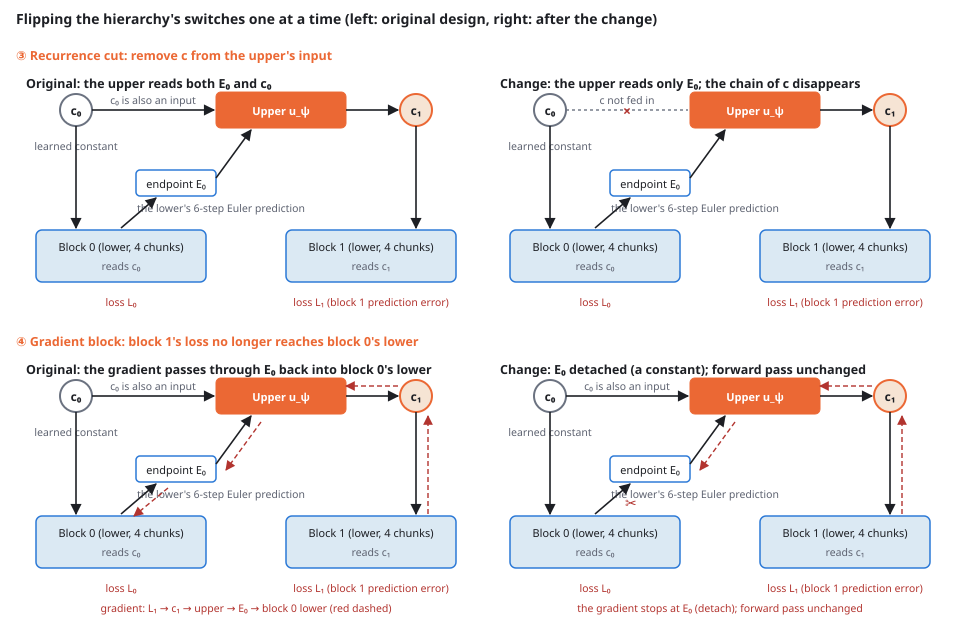

## What I tried

I wanted a hierarchy in which the upper level is never given a human-designed goal. On top of a lower level that predicts the future and acts every 8 steps, I placed an upper level that runs every 32 steps. The upper reads only the endpoints the lower predicted, returns one token in the lower's latent space, and the content of that token is decided by one thing alone: whether it makes the next block's predictions better. The designer does not decide what about the next 32 steps should be summarized; the lower's loss decides. If such a hierarchy beats a flat model with no upper, there is no need to design what the upper should learn.

The result: the lower barely read the upper at all. Pinning the upper's output to a constant left the closed-loop success rate unchanged, and under teacher forcing the amount by which the upper's output moves the lower's predictions was 0.6 to 0.7% of the block loss. On top of that, the hierarchy lost to flat by 4.8 pp. I flipped the two suspect switches one at a time; one of them turned out to be the source of the harm, but removing it only brought the hierarchy level with flat, not above it. Whether there is any information for an upper level to add at all is measured in the next post, [Even the true latent 32 steps ahead does not beat a flat model with no upper](../pusht-hierarchy-oracle-ceiling/).

## Setup

- **Task**: Push-T [[1]](#ref-1) [[2]](#ref-2). A circular agent pushes a T-shaped block to a fixed target pose on the board. The policy learns by imitation only, from demonstrations (17,990 training episodes, 439 test episodes, the expert data released with LeWorldModel [[3]](#ref-3)), with no reward and no interaction with the environment
- **Evaluation**: fixed-goal closed loop over 439 episodes. The policy runs from each test episode's initial state and succeeds if, within 300 steps, the T reaches (256, 256, 45°) within 20 px in position and 20° in angle. The policy receives no goal. 63.3% of the demonstrations end inside this criterion (the imitation ceiling)

{fig-alt="Timeline of one episode from step 0 to 80. Ten blue chunk boxes of 8 steps each on the lower lane; one orange upper box over the end of block 0 emits token c1, which fans out to chunks 4 to 7; a dashed box marks the next upper call. A panel below describes the flat baseline that reads a learned constant c0."}

- **Lower**: a flow-matching [[5]](#ref-5) predictor that outputs the next 8 steps of image latents, actions and positions at once, conditioned on the last 8 observations (4 image tokens from a frozen I-JEPA ViT-H/14 [[4]](#ref-4), a 2-d action and a 2-d agent position per step). Width 1,280, 8 layers, 330M parameters, with cross-attention to one memory token in every layer. At inference it produces the endpoint with 6 Euler steps, executes the 8 actions and replans
- **Upper**: reads the predicted endpoints (136 tokens) the lower produced over the previous block (32 steps = 4 chunks) and emits one token c (1,280-d) in the lower's latent space. Width 1,536, 12 layers, 350M parameters. **It has no loss of its own.** Its only training signal is the next block's lower loss arriving through c
- **flat**: no upper; every block reads a learned constant c₀. Lower architecture, initialization, data and random streams are identical to the hierarchy (hier); the only difference is whether an upper exists
- **One training window**: 2 blocks (8 steps of history + 64 steps). The upper runs once per window (c₀ → c₁)

{fig-alt="Box diagram of one training window: c0 and the endpoint E0 of block 0 feed the orange upper box, which outputs c1 read by block 1. Red dashed arrows trace the gradient of the block 1 loss back through c1, the upper and E0 into block 0."}

The closed-loop conditions and the quantity that measures whether the upper is used:

| Symbol | Meaning |
|---|---|
| euler6 (normal) | Run with the upper's output c updated every 32 steps. This is the condition used for the verdict |
| hold | Run with c pinned to c₀. If this matches normal, updating c has no effect on control |
| c_mean | Run with c pinned to the mean over 4,096 training windows |
| u_c | Under teacher forcing (1,024 validation windows, τ = 0), the increase in block 1's loss when c is pinned to c₀. How much the upper's output moves the lower's predictions |
| Difference and interval | Difference in success rate on the same 439 episodes (pp = percentage points). Paired bootstrap with 10,000 resamples, seed 999, 95% interval |

## Where the suspicion came from

The first time I ran this design, the hierarchy lost to flat by 4.8 pp (128 vs 149 episodes), the hold condition with c pinned to a constant had the same success rate, and u_c was 0.7% of block 1's loss. A post-hoc breakdown pointed at two suspects.

- **③ The upper's input differs between training and inference.** In training the upper's input is always c₀, but at inference it receives its own outputs c₁, c₂, …. On long episodes of 151 steps or more, hold tended to beat normal (+3.3 pp, interval including 0), which suggests the upper was being driven by inputs it never saw in training.
- **④ The gradient through the upper distorts the lower.** Even hold does not reach flat. The gap may come not from the value of c but from the gradient of block 1's loss flowing back through the upper into block 0's lower, a pressure flat never experiences, shaping the lower's weights.

When I first addressed ③ by changing the training procedure so the upper would experience the same chain as inference (c₀ → c₁ → c₂ → …) during training, the sampling scheme and the EMA decay formula changed at the same time, and the flat baseline itself collapsed from 149 to 82 episodes. After reverting both and confirming that the baseline recovered (158 episodes, +2.1 pp [−2.7, +6.8] against the original), I first built an implementation that reproduces the original bit for bit, then flipped exactly one switch at a time to obtain the results below. flat was rerun with the same implementation to confirm that the baseline reproduces.

## Results: the upper is not read, and cutting the recurrence only catches up

{fig-alt="Four box diagrams in two rows. Top row: the original window where the upper reads both E0 and c0, and the variant where the c0 input is cut. Bottom row: the original gradient path through E0 into block 0, and the variant where E0 is detached so the red dashed gradient stops there."}

| Arm | Change | euler6 | hold | c_mean | u_c | vs flat (pp) |
|---|---|---:|---:|---:|---:|---|
| flat | — | 154 (35.1%) | — | — | — | — |
| Gradient block | ④ | 129 (29.4%) | 132 | 122 | 0.6% | −5.7 [−10.3, −1.4] |
| Recurrence cut | ③ | 142 (32.3%) | 150 | 148 | 0.6% | −2.7 [−7.1, +1.6] |

- **The upper is not read.** In both arms, hold (c pinned to a constant) and c_mean (c pinned to the mean) match or exceed normal. The loss increase u_c when c is pinned under teacher forcing is 0.6% of block 1's loss; the amount by which c moves the lower's predictions is negligible.
- **Blocking the gradient changes nothing.** The result matches the first run of the hierarchy (128 episodes, hold 130), and the −5.7 pp gap to flat remains. Suspect ④ is rejected, and this arm doubles as a reproduction of the original design.
- **Cutting the recurrence removes the harm but does not beat flat.** The interval of the difference to flat includes 0, the first time a hierarchy in this series has left the "harmful" range. On long episodes of 151 steps or more it is +11.3 pp [+4.6, +17.9] over the gradient-block arm, so the harm from feeding the upper a c it never saw in training was real. But hold 150 and c_mean 148 ≥ normal 142: the upper adds no information.

The teacher-forced loss of the hierarchy is slightly lower than flat's (−2.1% on block 0), yet it loses in the closed loop. The upper was emitting something that nudges prediction accuracy without affecting control. Running flat twice gave a difference of +1.1 pp [−3.4, +5.7], which is the rough reproducibility width of this setup.

## Conclusion

Unless the upper's output is anchored to an external ground truth, nothing pressures the lower to read c. When the upper is trained only through the lower's loss, the lower settles its predictions within the range it can get right without reading c, and the upper keeps emitting values near c₀. That is why u_c never moved from below 1% in any arm.

This alone, however, cannot distinguish "the upper is trained the wrong way" from "there is no information in Push-T for an upper to add". In the first case it is worth moving to a design with a loss on the upper; in the second there is no point continuing with hierarchies on Push-T. The [next post](../pusht-hierarchy-oracle-ceiling/) makes that distinction by replacing the upper with the true latent 32 steps ahead and measuring the ceiling.

## Open issues

- One seed per arm. The intervals come only from resampling the evaluation episodes (439) and do not include training variance. Differences smaller than the reproducibility width (+1.1 pp [−3.4, +5.7]) cannot be read.
- flat was recorded on a different VM and GPU; rerunning the same weights shifts the count by a few episodes.
- The task is a single fixed-goal Push-T. Tasks whose goal changes per episode, or that need information not visible in 8 steps of history, could give a different result.

## Setup details

- Data: Push-T expert data `quentinll/lewm-pusht` (released with LeWorldModel [[3]](#ref-3)). Encoder: frozen I-JEPA ViT-H/14, 4 image tokens per step (precomputed)
- Training: 10,000 updates per arm, batch of 64 windows (= 512 chunk samples), AdamW lr 1e-4, 500 warmup steps + cosine, EMA (decay 1 − t^−0.75; changing the decay formula to (1 − 1/t)^1.75 alone drops the closed loop by 7 pp, so it is held fixed). One or two H100 or A100 GPUs; flat 2 to 4 hours, hierarchy 6 to 13 hours
- Evaluation: fixed-goal closed loop over 439 episodes, 6 Euler steps, initial noise σ = 0.02. Differences by paired bootstrap with 10,000 resamples, seed 999
- Cost: about 250 USD of GPU time for the two experiments; about 415 USD including the four flat runs used to recover the baseline

## References

1. []{#ref-1}Pete Florence, Corey Lynch, Andy Zeng, et al. [Implicit Behavioral Cloning](https://arxiv.org/abs/2109.00137). CoRL 2021.
2. []{#ref-2}Cheng Chi, Siyuan Feng, Yilun Du, Zhenjia Xu, et al. [Diffusion Policy: Visuomotor Policy Learning via Action Diffusion](https://arxiv.org/abs/2303.04137). RSS 2023.
3. []{#ref-3}Lucas Maes, Quentin Le Lidec, Damien Scieur, Yann LeCun, et al. [LeWorldModel: Stable End-to-End Joint-Embedding Predictive Architecture from Pixels](https://arxiv.org/abs/2603.19312). arXiv:2603.19312, 2026.
4. []{#ref-4}Mahmoud Assran, Quentin Duval, Ishan Misra, Piotr Bojanowski, et al. [Self-Supervised Learning from Images with a Joint-Embedding Predictive Architecture](https://arxiv.org/abs/2301.08243). CVPR 2023.
5. []{#ref-5}Yaron Lipman, Ricky T. Q. Chen, Heli Ben-Hamu, Maximilian Nickel, Matt Le. [Flow Matching for Generative Modeling](https://arxiv.org/abs/2210.02747). ICLR 2023.
