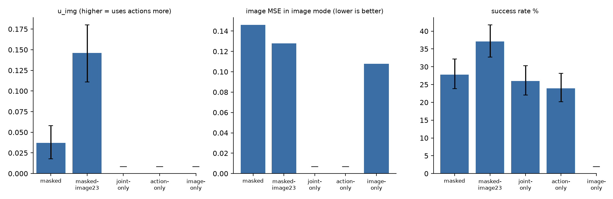

[日本語版](../../../ja/posts/pusht-role-mixing/index.qmd)

## What I tried

I wanted to test the role mixing from Cosmos Policy. The predictor outputs future image latents and actions together, but for each training sample some of the future tokens are given their clean ground truth, with no noise, as a condition. Only the remaining tokens are prediction targets with a loss.

Cosmos Policy does this with a diffusion model and reports higher success rates on robot manipulation. Here I check whether the same effect shows up with a flow-matching predictor.

{fig-alt="Four rows: the clean token sequence, then the joint, image and action sample types with conditioning tokens in green and noisy target tokens in red"}

Depending on which tokens get the ground truth, one predictor learns three functions. I call these three the "modes".

| mode | future images | future actions | function learned | share |
|---|---|---|---|---:|
| joint | target | target | predict images and actions together | 50% |
| image | target | condition | world model: images from actions | 25% |
| action | condition | target | inverse dynamics: actions from images | 25% |

I compare the following four variants.

| variant | future images | future actions |
|---|---|---|
| masked | the three modes mixed 50/25/25 | same |
| joint-only | always target | always target |
| action-only | not used | always target |
| image-only | always target | always condition |

## Setup

The predictor is a Transformer that lays out images and actions as one token sequence and predicts the next 8 steps from the previous 8. Images are latents from a frozen I-JEPA; actions are 2-D values. The flow-matching source is the last latent plus noise, and the predictor outputs the endpoint directly.

I used three measures.

- **Prediction error**: the MSE of future images and actions produced in a single step from the noisy source, given the expert's past
- **Closed-loop success rate**: Push-T is the task of pushing a T-shaped block into a fixed goal position and orientation. I call a group of 8 actions a "chunk". From each of the 439 test initial states, the predictor outputs a chunk, which is executed before it predicts again. Success means the block comes within 20 px and 20° of the goal within 300 steps. The goal is not an input to the predictor. Generation uses 6 Euler steps
- **Condition use u_img**: how much the image error drops, as a fraction, when the true future actions are given

$$
u_{\text{img}} = 1 - \frac{\text{image MSE in image mode}}{\text{image MSE in joint mode}}
$$

The larger u_img, the more the image prediction uses the given actions. u_act is the reverse: how much the action error drops when the true future images are given.

## Round 1: the policy improves, but image prediction ignores the actions

First I trained four variants with images at all 8 future steps. Errors are in joint mode.

| variant | image MSE | action MSE | success rate | vs joint-only, with 95% CI |
|---|---:|---:|---:|---|
| masked | 0.120 | 0.149 | 32.1% | +12.3 [+8.0, +16.6] |
| joint-only | 0.115 | 0.171 | 19.8% | — |
| action-only | 0.716 | 0.341 | 22.1% | +2.3 [−1.8, +6.4] |
| image-only | — | — | — | — |

masked's success rate is 12.3 points higher than joint-only's. This is an effect in the same direction as in Cosmos Policy.

But masked's image prediction barely uses the given actions. Its image MSE in image mode, where actions are given, is 0.118, almost the same as 0.120 in joint mode. image-only, which always trains with actions given, gets down to 0.080. The action prediction, in contrast, uses the given future images heavily, with u_act at 0.57–0.69.

image-only always trains with actions given, so it has no joint-mode values, and it cannot output actions, so it cannot run in closed loop.

## Isolating the cause

I had two hypotheses.

- **Hypothesis A**: actions are only 2-D, so clean ground truth and noisy targets are hard to tell apart
- **Hypothesis B**: only a quarter of masked's samples are image-mode, so the image loss gets a weak training signal from the actions

I looked inside the predictor. A linear classifier that tells clean from noisy tokens from their vector values alone gets about 0.5 accuracy for both actions and images, which is chance. The only cue is the role embedding. With it included, the separation between the two groups is 0.83 for actions and 0.64 for images, larger for actions. Hypothesis A does not hold.

Image tokens put 3.7% of their attention on clean actions, less than image-only's 10.1%, and blocking that path barely changes the image error. This is consistent with hypothesis B.

## Round 2: one future image, and a larger image-mode share

Cosmos Policy predicts a single future image at the end of the chunk. I matched this by keeping only the image 8 steps ahead. To test hypothesis B directly, I also added masked-image23, which raises the image-mode share to 2/3. Its shares are joint 1/6, image 2/3, action 1/6.

{fig-alt="Three bar charts comparing the five variants on condition use, image MSE given actions, and success rate"}

| variant | image-mode image MSE | joint image MSE | u_img | action MSE | success rate |
|---|---:|---:|---:|---:|---:|
| masked | 0.1462 | 0.1518 | 0.037 [0.018, 0.058] | 0.160 | 27.8% |
| masked-image23 | 0.1276 | 0.1494 | 0.146 [0.111, 0.180] | 0.153 | 37.1% |
| joint-only | — | 0.1517 | — | 0.166 | 26.0% |
| action-only | — | — | — | 0.221 | 23.9% |
| image-only | 0.1075 | — | — | — | — |

— marks a mode the variant was not trained on.

| success-rate difference | difference | 95% confidence interval |
|---|---:|---|
| masked − joint-only | +1.8 | [−2.5, +5.9] |
| masked-image23 − masked | +9.3 | [+4.8, +13.9] |
| masked-image23 − joint-only | +11.2 | [+6.6, +15.5] |

Four findings.

1. **In the Cosmos setting, the effect of 50/25/25 is unclear.** With a single future image, masked's advantage over joint-only shrinks to 1.8 points, which is not distinguishable from zero. masked went down and joint-only went up. masked's drop is consistent with inverse dynamics now having one future image to read instead of eight.
2. **With a single future image, 50/25/25 masked still ignores the actions.** u_img is 0.037.
3. **A larger image-mode share makes image prediction use the actions.** masked-image23's u_img is 0.146, four times masked's. Its image-mode image MSE is also 0.0185 lower. It still does not reach image-only's 0.1075.
4. **A larger image-mode share also improves the policy.** masked-image23's success rate is 37.1%, the best of all variants. That is 9.3 points above masked and 11.2 points above joint-only. Only a third of its samples have actions as targets, yet it improved. I have not yet tested why.

The world model does not work in closed loop. Predicting the image latent 8 steps ahead along the trajectories the policy actually took, every variant loses to a baseline that just returns the current latent. The model and baseline MSEs are 0.29 and 0.27 for masked, 0.30 and 0.26 for masked-image23, and 0.26 and 0.23 for joint-only, each in a mode the variant was trained on. On expert data the models' error is one fifth of the baseline's. I suspect the difference between how the expert and the policy move, but I have not checked it yet.

## Conclusion

With the same 50/25/25 shares as Cosmos Policy, the effect under flow matching was unclear. With 8 future images the policy improved by 12.3 points, but with a single image, as in Cosmos, the gap shrank to 1.8 points. The world model did not benefit in either case.

Raising the image-mode share to 2/3 made the image prediction use the actions, and the success rate became the best of all variants. When using role mixing with flow matching, raising the image-mode share looks effective. These are results from one seed per variant.

## Open problems

- Make the world model work on the policy's own trajectories, by mixing those trajectories into training
- Try image-mode shares of 1/2 and 5/6 to see whether the effect is monotonic in the share
- Combine 8 future images with a 2/3 image-mode share to see whether the two effects add up
- Add seeds. The current confidence intervals come only from resampling evaluation samples and do not include training variance

## Setup details

- Data: Push-T expert data `quentinll/lewm-pusht`; 17,990 training episodes, 256 validation, 439 test
- Encoder: I-JEPA ViT-H/14, frozen, 224 px, 4 image tokens per step
- Predictor: Transformer, width 1,280, 8 layers, 10 heads
- Training: 50,000 updates, batch 256, one H100 per variant, 3.5 to 4 hours
- Evaluation: 1,024 samples from validation episodes, EMA weights, paired bootstrap with 10,000 resamples for 95% confidence intervals; closed loop bootstraps over episodes
- Inference time: per chunk, 5.7 ms with 1 Euler step and 33 to 35 ms with 6, on an H100 with batch 1
