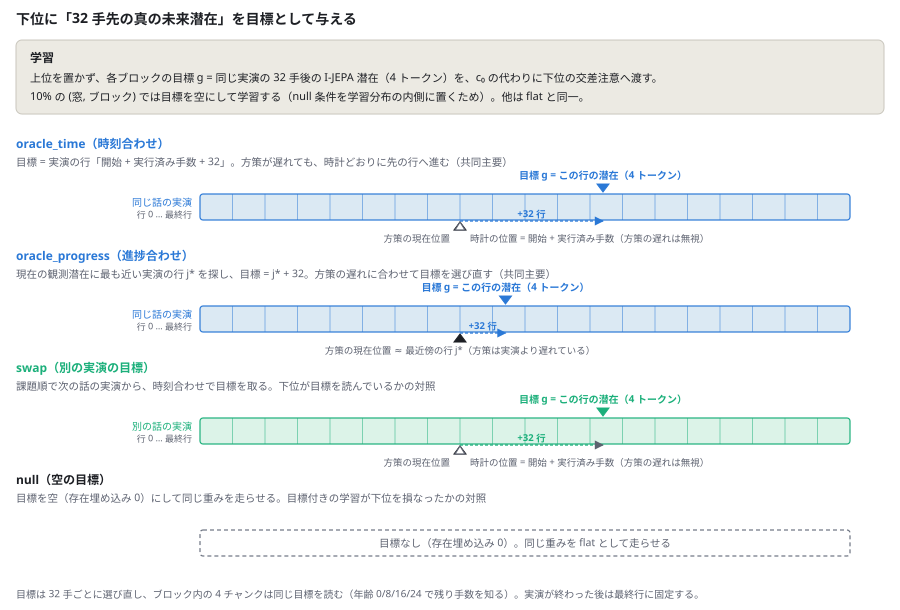
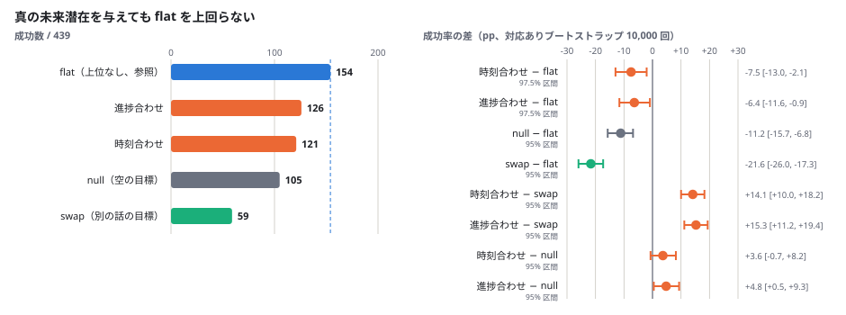
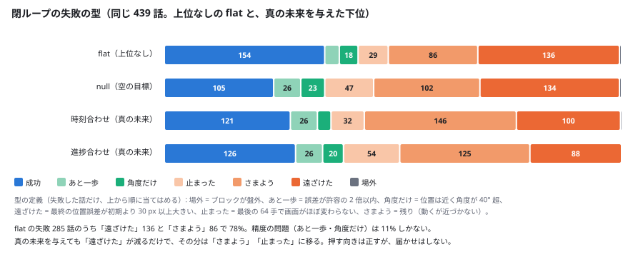
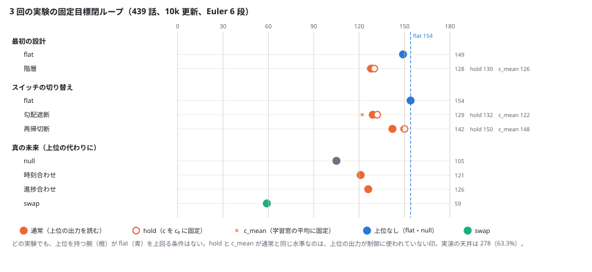

## 何を試したか

[最初の記事](../pusht-hierarchy-upper-unread/) で、上位に損失を置かない階層は下位に読まれず、疑わしい箇所を 1 つずつ切り替えても害が消えるだけで flat を上回りませんでした。残った問いは「上位の学習のさせ方が悪い」のか「Push-T には上位が足せる情報がそもそもない」のかです。

区別するために、上位の学習を外し、上位が出しうる最良の出力を直接与えて天井を測りました。各ブロックの目標として、同じ実演の 32 手後の真の潜在を下位に渡します。上回れば「完璧な上位があれば伸びしろはある」ので、次は上位を未来潜在の予測器として学習します。上回らなければ、Push-T では上位が埋める隙間がないと判断し、階層の研究を別の課題へ移します。この分岐を事前登録してから走らせました。

結果は、上回りませんでした。真の未来を与えた下位は flat を 6〜8 pp 下回ります。下位が目標を読んでいないのではなく、別の話の目標を渡すと 14〜15 pp 落ちるほど強く読んだ上で、閉ループでは勝てません。失敗の型を見ると、精度の問題ではなく「押し損ねて離れる」型が 8 割で、正しい中間目標があっても下位はそこへ届きません。

## 設定

モデルと評価は [最初の記事](../pusht-hierarchy-upper-unread/) と同じです。

- **下位**: 過去 8 手の観測から未来 8 手を一度に出すフローマッチングの予測器。幅 1,280・8 層、3.3 億パラメータ、各層に記憶 1 トークンへの交差注意
- **flat**: 上位を持たず、学習する定数 c₀ を記憶トークンとして読む
- **評価**: 固定目標の閉ループ 439 話。予算 300 手、T 字ブロックが (256, 256, 45°) に位置 20 px・角度 20° 以内で成功
- **この記事の学習**: 各ブロックの目標 g = 同じ実演の 32 手後の I-JEPA 潜在（4 トークン）を、c₀ の代わりに下位の交差注意へ渡す。10% の (窓, ブロック) では目標を空にして学習。それ以外（学習窓・データ乱数列・フロー乱数列）は flat と更新ごとに一致

閉ループで目標をどう与えるかは自明ではありません。方策は実演どおりには動かず、遅れたり別の経路を取ったりします。そこで「同じ実演の 32 手先」の定義を 2 通り用意し、どちらかが flat を上回れば天井ありとしました（Bonferroni 補正、各 97.5% 区間）。対照として、別の話の実演から目標を取る swap と、目標を空にする null を加えます。

{fig-alt="Four strips of demonstration rows. Time-aligned: goal at the clock row plus 32. Progress-aligned: goal at the nearest row j star plus 32. Swap: the same clock rule applied to another episode's demonstration in green. Null: a dashed empty box, no goal."}

| 条件 | 目標 |
|---|---|
| 時刻合わせ | 実演の行「開始 + 実行済み手数 + 32」の潜在。方策が遅れても時計どおりに先へ進む |
| 進捗合わせ | 現在の観測潜在に最も近い実演の行 j* を探し、j* + 32 の潜在。方策の遅れに合わせる |
| swap | 課題順で次の話の実演から、時刻合わせで目標を取る。下位が目標を読んでいるかの対照 |
| null | 目標を空にして同じ重みを走らせる。目標付きの学習が下位を損なったかの対照 |

目標は 32 手ごとに選び直し、ブロック内の 4 チャンクは同じ目標を読みます。実演が終わった後は最終行に固定します。

## 結果

{fig-alt="Left: horizontal bars of success counts, flat 154, progress-aligned 126, time-aligned 121, null 105, swap 59, with a dashed line at the flat value. Right: eight rows of difference estimates with confidence intervals; the two primary rows against flat sit entirely below zero, the rows against swap entirely above zero."}

| 条件 | 成功数 / 439 | 対 flat | 対 swap | 対 null |
|---|---:|---|---|---|
| flat（参照） | 154（35.1%） | — | — | — |
| 時刻合わせ | 121（27.6%） | −7.5 pp [−13.0, −2.1]（97.5%） | +14.1 pp [+10.0, +18.2] | +3.6 pp [−0.7, +8.2] |
| 進捗合わせ | 126（28.7%） | −6.4 pp [−11.6, −0.9]（97.5%） | +15.3 pp [+11.2, +19.4] | +4.8 pp [+0.5, +9.3] |
| null（空の目標） | 105（23.9%） | −11.2 pp [−15.7, −6.8] | — | — |
| swap（別の話の目標） | 59（13.4%） | −21.6 pp [−26.0, −17.3] | — | — |

読むべき点は 3 つです。

1. **天井は flat より低い。** 正しい 32 手先の潜在を与えても、2 つの定義のどちらでも flat に 6〜8 pp 負けます。定義の違い（+1.1 pp [−2.1, +4.6]）は結果を変えません。
2. **下位は目標を強く読んでいる。** 別の話の目標（swap）では 59 話まで落ち、正しい目標より 14〜15 pp 低くなります。教師強制でも、目標を外すと損失は 3.24 → 4.42（null）、別の話にすると 8.87（swap）まで上がります。最初の記事の c（上位の出力を固定しても損失は 0.6〜0.7% しか増えない）とは違い、目標は下位の予測を大きく動かします。それでも閉ループでは勝てません。
3. **目標を読む下位を作ると、目標なしの方策が弱くなる。** 同じ重みを目標なしで走らせた null は flat より 11.2 pp 低く、正しい目標で取り戻せるのは +4〜5 pp にとどまります。教師強制の損失はブロックあたり 1.62（flat 1.99〜2.11）と大きく下がるのに、閉ループの成功率は上がりません。オフラインの改善は閉ループに出ませんでした。

事前登録の規則どおり、判定は「Push-T では上位が埋める隙間がない」です。

## なぜ効かないのか

**Push-T の固定目標課題では、8 手の履歴でほぼ足りる。** 目標は固定で、現在の観測に写っています。32 手先の情報が成功を分ける話が少ないなら、完璧な上位にも埋める隙間がありません。この実験がその実測です。

**失敗の主型は「押し損ねて離れる」で、精度の問題ではない。** この後の実験まで含めた 16 条件の閉ループ記録を同じ 439 話で突き合わせ、失敗を最終状態と画面変化量で型に分けました（2026-11-05 の事後分析）。

{fig-alt="Four stacked horizontal bars over 439 episodes for flat, null, time-aligned and progress-aligned: success in blue on the left, then near-miss, angle-only, stalled, wandering and moved-away segments in greens and oranges. Moved-away shrinks from 136 to 88 with the true future while wandering and stalled grow."}

flat の失敗 285 話のうち、押す向きを誤って状況を悪化させた「遠ざけた」が 136、動くが近づかない「さまよう」が 86 で、合わせて 78% です。精度の問題（あと一歩・角度だけ）は 11% しかありません。成功は開始時点の課題の長さでほぼ決まり、初期の角度誤差が 100° 以上の 119 話は flat で 9〜11%、実演が目標で終わらない 161 話では 23% です。真の未来（進捗合わせ）は null の失敗 334 話のうち 59 話を直し、成功 105 話のうち 38 話を壊しますが、直るのは実演の残りが 40 手未満の短い話で、上位なしの 7 条件すべてで失敗する 151 話のうち直るのは 11 話だけです。**上位が助けるはずの長い課題で、真の未来はほとんど効きませんでした。** 正しい中間目標があっても、「T 字ブロックの反対側へ回って押し直す」といった複数回の接触を要する手順を下位が実行できなければ届きません。

容量の参照として、以前の階層実験で階層と同じ総パラメータ数を 1 つの flat に与えた flat-big（幅 1,280・20 層、5.9 億）は 46.5%（204/439）でした。学習は 60,000 更新で本記事の腕の 6 倍、下位の設計も当時のものなので直接の比較ではありませんが、容量を階層に分けるより flat に積む方が伸びる、という向きは示しています。

## 3 回の実験を 1 枚に

この記事までの 2 本で、Push-T の階層型世界モデルを 3 回の実験（階層 3 本と、上位の代わりに真の未来を与えた 4 条件）で試しました。全腕の成功数を 1 枚にまとめます。

{fig-alt="Dot plot of success counts out of 439 for every arm of three experiments, grouped by experiment. Blue dots are flat baselines, orange dots are hierarchies with open circles for the hold condition and crosses for the mean condition. A dashed vertical line at 154 marks the flat reference; no orange dot lies to its right."}

| 実験 | 腕 | euler6 | hold | c_mean | u_c |
|---|---|---:|---:|---:|---:|
| 最初の設計 | flat | 149 | — | — | — |
| 最初の設計 | 階層 | 128 | 130 | 126 | 0.7% |
| スイッチの切り替え | flat | 154 | — | — | — |
| スイッチの切り替え | 勾配遮断 | 129 | 132 | 122 | 0.6% |
| スイッチの切り替え | 再帰切断 | 142 | 150 | 148 | 0.6% |
| 真の未来 | null | 105 | — | — | — |
| 真の未来 | 時刻合わせ | 121 | — | — | — |
| 真の未来 | 進捗合わせ | 126 | — | — | — |
| 真の未来 | swap | 59 | — | — | — |

最初の設計とスイッチの切り替えは [上位に損失を置かない階層型世界モデルは、下位に読まれない](../pusht-hierarchy-upper-unread/)、真の未来がこの記事です。

## 結論

- 上位の出力に外部の正解がなければ下位は読まず、外部の正解（真の未来）を与えても閉ループは flat に届きません。Push-T の固定目標課題には、32 手ごとの上位が埋める隙間がありません。
- 失敗の 8 割は押し損ねて離れる型で、32 手先の情報では直りません。直るのは残りが短い話だけです。
- 事前登録では「天井がなければ階層を別の課題へ移す」としていましたが、上位に損失を置く、記憶の情報量に料金をかける、符号器と予測器の JEPA 型にする、といった上位の設計をその後 6 回試しました。読まれる上位は作れましたが、閉ループは変わりませんでした。別の記事にします。

## 残る課題

- 天井は「この下位にとっての」天井です。目標の与え方（交差注意 4 トークン）や 10k 更新で下位が目標を十分に使えないなら、天井を低く見積もっています。
- 目標付きの学習が目標なしの方策を弱くした点（null −11.2 pp）は未解明です。
- 各腕 1 seed です。flat は別の VM・GPU で走った記録で、同じ重みでも再実行で数話ずれます。null 条件はこのずれの参照を兼ねています。
- 課題は固定目標の Push-T 1 つです。目標が話ごとに変わる課題や、履歴 8 手では分からない情報が要る課題では別の結果になりえます。

## 実験条件

- データ・モデル・評価は [最初の記事](../pusht-hierarchy-upper-unread/) と同じ。符号化器は凍結 I-JEPA ViT-H/14 [[4]](#ref-4)、下位はフローマッチング [[5]](#ref-5) の予測器、データは LeWorldModel [[3]](#ref-3) の公開した Push-T [[1]](#ref-1) [[2]](#ref-2) の専門家実演
- 学習: 10,000 更新、バッチ 64 窓（= 512 チャンク標本）、AdamW lr 1e-4、warmup 500 + cosine、EMA。H100 1 枚で約 9 時間
- 評価: 固定目標閉ループ 439 話、Euler 6 段、始点雑音 σ = 0.02。差は対応ありブートストラップ 10,000 回、seed 999。主要 2 条件は Bonferroni 補正の 97.5% 区間
- 記録: [world-model-qa](https://github.com/miraiyochi-ai/world-model-qa) の `experiments/pusht_s15_oracle_subgoal_ceiling`。失敗の型の事後分析と flat-big（`experiments/pusht_s8_hier_shared_latent`）も同じリポジトリ。図を描くスクリプトは `docs/research/pusht-hierarchy-series/make_figs.py`
- 費用: GPU 約 22 ドル。系列全体では約 440 ドル（基準線の回復に使った分を含む）

## 参考文献

1. []{#ref-1}Pete Florence, Corey Lynch, Andy Zeng, et al. [Implicit Behavioral Cloning](https://arxiv.org/abs/2109.00137). CoRL 2021.
2. []{#ref-2}Cheng Chi, Siyuan Feng, Yilun Du, Zhenjia Xu, et al. [Diffusion Policy: Visuomotor Policy Learning via Action Diffusion](https://arxiv.org/abs/2303.04137). RSS 2023.
3. []{#ref-3}Lucas Maes, Quentin Le Lidec, Damien Scieur, Yann LeCun, et al. [LeWorldModel: Stable End-to-End Joint-Embedding Predictive Architecture from Pixels](https://arxiv.org/abs/2603.19312). arXiv:2603.19312, 2026.
4. []{#ref-4}Mahmoud Assran, Quentin Duval, Ishan Misra, Piotr Bojanowski, et al. [Self-Supervised Learning from Images with a Joint-Embedding Predictive Architecture](https://arxiv.org/abs/2301.08243). CVPR 2023.
5. []{#ref-5}Yaron Lipman, Ricky T. Q. Chen, Heli Ben-Hamu, Maximilian Nickel, Matt Le. [Flow Matching for Generative Modeling](https://arxiv.org/abs/2210.02747). ICLR 2023.
