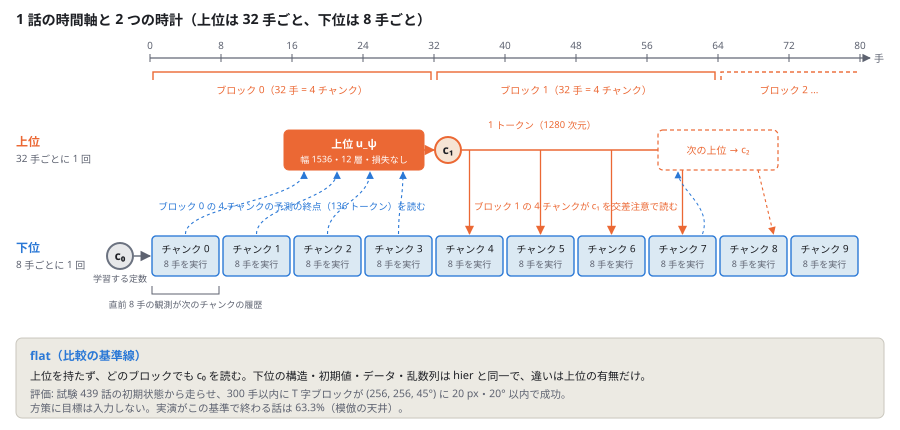
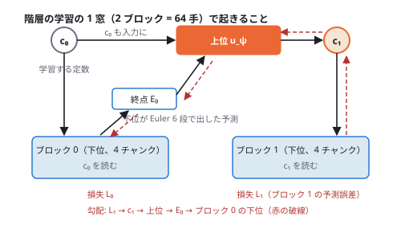
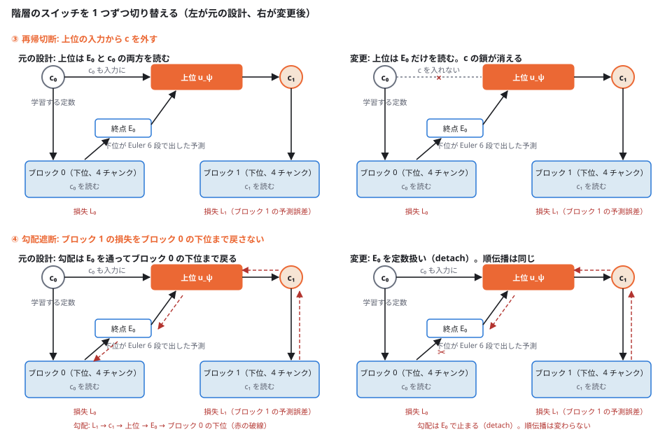

## 何を試したか

試したかったのは、上位に人間が決めた目標を一切与えない階層です。8 手ごとに未来を予測して行動する下位の上に、32 手ごとに走る上位を置きます。上位は下位が予測した終点だけを読み、下位の潜在空間に 1 トークンを返し、その中身は「次のブロックの予測が良くなるかどうか」だけで決まります。32 手先の何を要約すべきかを設計者が決めず、下位の損失に決めさせる構成です。これで階層が上位を持たない flat を上回るなら、上位に何を学ばせるかを設計しなくてもよいことになります。

結果は、上位は下位にほとんど読まれませんでした。上位の出力を定数に固定しても閉ループの成功率は変わらず、教師強制で測った「上位の出力が下位の予測を動かす量」はブロック損失の 0.6〜0.7% でした。しかも階層は flat に 4.8 pp 負けます。疑わしい箇所を 2 つ、1 つずつ切り替えて確かめたところ、害の原因は 1 つ特定できましたが、害が消えるだけで上回りはしませんでした。上位が足せる情報がそもそもあるのかは、続く記事 [真の 32 手先を教えても、上位なしの flat に勝てない](../pusht-hierarchy-oracle-ceiling/) で測っています。

## 設定

- **課題**: Push-T [[1]](#ref-1) [[2]](#ref-2)。円形のエージェントで T 字ブロックを押し、盤上の固定の目標姿勢へ運ぶ。方策は実演（学習 17,990 話、試験 439 話、LeWorldModel [[3]](#ref-3) が公開した専門家データ）の模倣だけで学習し、報酬も環境との相互作用も使わない
- **評価**: 固定目標の閉ループ 439 話。試験話の初期状態から方策を走らせ、300 手以内に T 字ブロックが (256, 256, 45°) に位置 20 px・角度 20° 以内で入れば成功。方策に目標は入力しない。実演がこの基準で終わる話は 63.3%（模倣の天井）

{fig-alt="Timeline of one episode from step 0 to 80. Ten blue chunk boxes of 8 steps each on the lower lane; one orange upper box over the end of block 0 emits token c1, which fans out to chunks 4 to 7; a dashed box marks the next upper call. A panel below describes the flat baseline that reads a learned constant c0."}

- **下位**: 過去 8 手の観測（凍結 I-JEPA ViT-H/14 [[4]](#ref-4) の画像潜在 4 トークン、行動 2 次元、エージェント位置 2 次元）から、未来 8 手の画像潜在・行動・位置を一度に出すフローマッチング [[5]](#ref-5) の予測器。幅 1,280・8 層、3.3 億パラメータ、各層に記憶 1 トークンへの交差注意。推論は Euler 6 段で終点を出し、行動 8 手を実行して再計画
- **上位**: 直前ブロック（32 手 = 4 チャンク）で下位が出した予測の終点（136 トークン）を読み、下位の潜在空間の 1 トークン c（1,280 次元）を作る。幅 1,536・12 層、3.5 億パラメータ。**損失は置かない。** 学習信号は、次のブロックの下位の損失が c を通って届くものだけ
- **flat**: 上位を持たず、学習する定数 c₀ をすべてのブロックで読む。下位の構造・初期値・データ・乱数列は階層（hier）と同一で、違いは上位の有無だけ
- **学習の 1 窓**: 2 ブロック（履歴 8 手 + 64 手）。上位は窓の中で 1 回だけ走る（c₀ → c₁）

{fig-alt="Box diagram of one training window: c0 and the endpoint E0 of block 0 feed the orange upper box, which outputs c1 read by block 1. Red dashed arrows trace the gradient of the block 1 loss back through c1, the upper and E0 into block 0."}

閉ループの条件と、上位が使われているかを測る量を表にまとめます。

| 記号 | 意味 |
|---|---|
| euler6（通常） | 上位の出力 c を 32 手ごとに更新して走らせる。判定はこの条件 |
| hold | c を c₀ に固定して走らせる。通常と同じなら、c の更新は制御に効いていない |
| c_mean | c を学習窓 4,096 本の平均に固定して走らせる |
| u_c | 教師強制（検証 1,024 窓、τ = 0）で c を c₀ に固定したときのブロック 1 の損失の増分。上位の出力が下位の予測をどれだけ動かすか |
| 差と区間 | 同じ 439 話での成功率の差（pp = 百分率ポイント）。対応ありブートストラップ 10,000 回、seed 999、95% 区間 |

## 疑いの出どころ

この設計を最初に走らせたとき、階層は flat に 4.8 pp 負け（128 対 149 話）、上位の出力 c を定数に固定した hold でも成功率は変わらず、u_c はブロック 1 損失の 0.7% でした。事後の層別で、疑わしい箇所が 2 つ見えました。

- **③ 学習と推論で上位の入力がずれる。** 学習では上位の入力はいつも c₀ ですが、推論では c₁, c₂, … と自分の出力が入ってきます。151 手以上の長い話では hold が通常を上回る向き（+3.3 pp、区間は 0 を含む）があり、学習で見ていない入力で動かしている疑いです。
- **④ 上位経由の勾配が下位を歪める。** hold でも flat に届きません。差は c の値ではなく、ブロック 1 の損失が上位を経由してブロック 0 の下位へ戻る勾配（flat には無い圧力）が下位の重みを形作ったせいかもしれません。

③ に最初に手を付けたとき、上位に推論と同じ鎖（c₀ → c₁ → c₂ → …）を学習中に経験させるために学習手順を変えたところ、標本の引き方と EMA の減衰式も同時に変わってしまい、flat の基準線自体が 149 話から 82 話に崩れました。両方を元に戻して基準線が回復する（158 話、元との差 +2.1 pp [−2.7, +6.8]）ことを確かめてから、最初の実装をビット一致で再現できる実装を先に作り、スイッチを 1 つだけ切り替えて以下の結果を取りました。flat も同じ実装で走らせ直して、基準線が再現することを確かめています。

## 結果: 上位は読まれず、再帰を切っても追いつくだけ

{fig-alt="Four box diagrams in two rows. Top row: the original window where the upper reads both E0 and c0, and the variant where the c0 input is cut. Bottom row: the original gradient path through E0 into block 0, and the variant where E0 is detached so the red dashed gradient stops there."}

| 腕 | 変更 | euler6 | hold | c_mean | u_c | 対 flat（pp） |
|---|---|---:|---:|---:|---:|---|
| flat | — | 154（35.1%） | — | — | — | — |
| 勾配遮断 | ④ | 129（29.4%） | 132 | 122 | 0.6% | −5.7 [−10.3, −1.4] |
| 再帰切断 | ③ | 142（32.3%） | 150 | 148 | 0.6% | −2.7 [−7.1, +1.6] |

- **上位は読まれていません。** どちらの腕も、c を定数に固定した hold と平均に固定した c_mean が通常と同じか上です。教師強制で c を固定したときの損失増分 u_c はブロック 1 損失の 0.6% で、c が下位の予測を動かす量は無視できます。
- **勾配遮断は何も変えません。** 最初に走らせたときの階層（128 話、hold 130）と同じ結果で、flat との差 −5.7 pp もそのまま残ります。疑い ④ は否定で、この腕が元の設計の再現を兼ねます。
- **再帰切断は害を取り除くが、上回りはしません。** flat との差の区間が 0 を含み、この系列の階層で初めて「有害」を外れました。151 手以上の長い話では勾配遮断より +11.3 pp [+4.6, +17.9] で、学習で見ていない c を入力にしていた害は確かにありました。しかし hold 150・c_mean 148 ≥ 通常 142 で、上位が足している情報はありません。

教師強制の損失は階層のほうが flat よりわずかに低い（ブロック 0 で −2.1%）のに、閉ループでは負けます。上位は「予測精度をわずかに上げるが制御には効かない」何かを出していました。flat を 2 度走らせた差は +1.1 pp [−3.4, +5.7] で、これが同じ設定の再現幅の目安です。

## 結論

上位の出力に外部の正解がない限り、下位が c を読む圧力はかかりません。下位の損失だけで上位を学習すると、下位は「c を読まなくても当てられる」範囲で予測を済ませ、上位は c₀ の近くの値を出し続けます。どの腕でも u_c が 1% 未満から動かなかったのはこのためです。

ただしこれだけでは「上位の学習のさせ方が悪い」のか「Push-T には上位が足せる情報がそもそもない」のかを区別できません。前者なら上位に損失を置く設計へ進む価値があり、後者なら Push-T で階層を続ける意味がありません。この区別は、上位の代わりに真の 32 手先の潜在を与えて天井を測る [次の記事](../pusht-hierarchy-oracle-ceiling/) で付けます。

## 残る課題

- 各腕 1 seed です。区間は評価標本（439 話）の再抽出だけによるもので、学習のばらつきは含みません。再現幅の目安（+1.1 pp [−3.4, +5.7]）より小さい差は読めません。
- flat は別の VM・GPU で走った記録で、同じ重みでも再実行で数話ずれます。
- 課題は固定目標の Push-T 1 つです。目標が話ごとに変わる課題や、履歴 8 手では分からない情報が要る課題では別の結果になりえます。

## 実験条件

- データ: Push-T の専門家データ `quentinll/lewm-pusht`（LeWorldModel [[3]](#ref-3) の公開データ）。符号化器は凍結 I-JEPA ViT-H/14、1 手あたり画像トークン 4 本（前計算）
- 学習: 各腕 10,000 更新、バッチ 64 窓（= 512 チャンク標本）、AdamW lr 1e-4、warmup 500 + cosine、EMA（減衰 1 − t^−0.75。減衰式を (1 − 1/t)^1.75 に変えるだけで閉ループが 7 pp 落ちるので固定）。H100 または A100 1〜2 枚で、flat 2〜4 時間、階層 6〜13 時間
- 評価: 固定目標閉ループ 439 話、Euler 6 段、始点雑音 σ = 0.02。差は対応ありブートストラップ 10,000 回、seed 999
- 費用: 2 実験で GPU 約 250 ドル。基準線の回復に使った 4 本の flat を含めると約 415 ドル

## 参考文献

1. []{#ref-1}Pete Florence, Corey Lynch, Andy Zeng, et al. [Implicit Behavioral Cloning](https://arxiv.org/abs/2109.00137). CoRL 2021.
2. []{#ref-2}Cheng Chi, Siyuan Feng, Yilun Du, Zhenjia Xu, et al. [Diffusion Policy: Visuomotor Policy Learning via Action Diffusion](https://arxiv.org/abs/2303.04137). RSS 2023.
3. []{#ref-3}Lucas Maes, Quentin Le Lidec, Damien Scieur, Yann LeCun, et al. [LeWorldModel: Stable End-to-End Joint-Embedding Predictive Architecture from Pixels](https://arxiv.org/abs/2603.19312). arXiv:2603.19312, 2026.
4. []{#ref-4}Mahmoud Assran, Quentin Duval, Ishan Misra, Piotr Bojanowski, et al. [Self-Supervised Learning from Images with a Joint-Embedding Predictive Architecture](https://arxiv.org/abs/2301.08243). CVPR 2023.
5. []{#ref-5}Yaron Lipman, Ricky T. Q. Chen, Heli Ben-Hamu, Maximilian Nickel, Matt Le. [Flow Matching for Generative Modeling](https://arxiv.org/abs/2210.02747). ICLR 2023.
