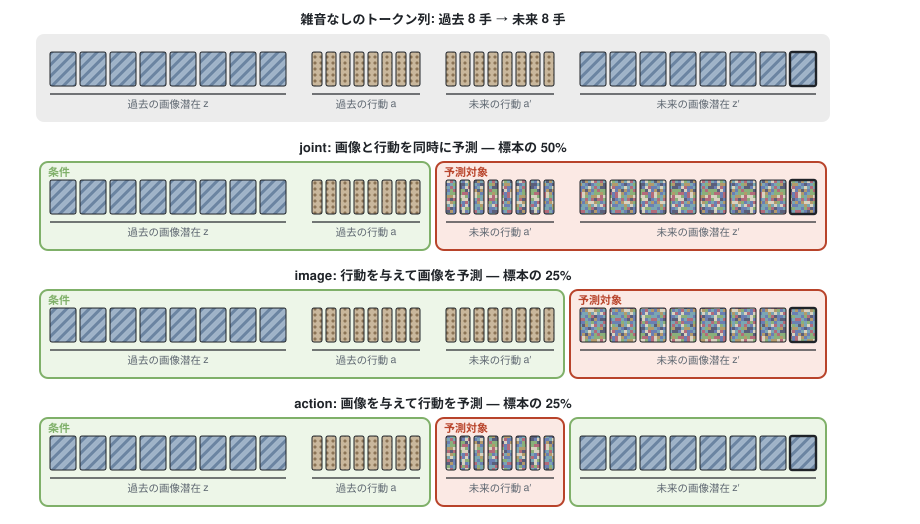

## 何を試したか

試したかったのは Cosmos Policy の役割混合です。予測器は未来の画像潜在と行動をまとめて予測しますが、学習標本ごとに、未来トークンの一部には雑音を混ぜない綺麗な正解をそのまま条件として与え、残りだけを予測対象にして損失を掛けます。

Cosmos Policy は拡散モデルでこれを行い、ロボット操作の成功率が上がったと報告しています。今回はフローマッチングの予測器でも同じ効果が出るかを確かめます。

{fig-alt="Four rows: the clean token sequence, then the joint, image and action sample types with conditioning tokens in green and noisy target tokens in red"}

正解を与えるトークンの選び方で、1 つの予測器が 3 つの関数を学びます。この 3 種類を以下「モード」と呼びます。

| モード | 未来画像 | 未来行動 | 学ぶ関数 | 比率 |
|---|---|---|---|---:|
| joint | 予測対象 | 予測対象 | 画像と行動を同時に予測 | 50% |
| image | 予測対象 | 条件 | 世界モデル: 行動から画像を予測 | 25% |
| action | 条件 | 予測対象 | 逆動力学: 画像から行動を予測 | 25% |

次の 4 つの実験群を比べました。

| 実験群 | 未来画像 | 未来行動 |
|---|---|---|
| masked | 上の 3 モードを 50/25/25 で混ぜる | 同左 |
| joint-only | 常に予測対象 | 常に予測対象 |
| action-only | 使わない | 常に予測対象 |
| image-only | 常に予測対象 | 常に条件 |

## 設定

予測器は画像と行動を 1 本のトークン列に並べ、過去 8 手を条件に未来 8 手を予測する Transformer です。画像は凍結した I-JEPA の潜在、行動は 2 次元の値です。フローマッチングの始点は直前の潜在に雑音を足したもので、終点を直接出力します。

評価には次の 3 つを使いました。

- **予測誤差**: 専門家データの過去を与え、雑音入りの始点から 1 段で出した未来の画像と行動の MSE
- **閉ループ成功率**: Push-T は T 字のブロックを決まった目標の位置と向きに押し込む課題です。8 手ぶんの行動のまとまりを「チャンク」と呼びます。試験 439 話の初期状態から、1 チャンクを予測して実行し、また予測する、を繰り返します。300 手以内にブロックが目標から 20 px・20° 以内に入れば成功です。予測器に目標は入力しません。生成は Euler 法 6 段です
- **条件使用 u_img**: 未来行動の正解を与えたとき、画像の誤差が何割下がるか

$$
u_{\text{img}} = 1 - \frac{\text{image モードの画像 MSE}}{\text{joint モードの画像 MSE}}
$$

u_img が大きいほど、画像予測が与えた行動を使っています。逆向きの u_act は、未来画像の正解を与えたときに行動の誤差が何割下がるかです。

## 第 1 ラウンド: 方策は良くなるが、画像予測は行動を使わない

まず未来 8 手すべてに画像を置いて、4 つの実験群を学習しました。誤差は joint モードの値です。

| 実験群 | 画像 MSE | 行動 MSE | 成功率 | joint-only との差と 95% 信頼区間 |
|---|---:|---:|---:|---|
| masked | 0.120 | 0.149 | 32.1% | +12.3 [+8.0, +16.6] |
| joint-only | 0.115 | 0.171 | 19.8% | — |
| action-only | 0.716 | 0.341 | 22.1% | +2.3 [−1.8, +6.4] |
| image-only | — | — | — | — |

masked の成功率は joint-only より 12.3 ポイント高くなりました。Cosmos Policy と同じ向きの効果です。

一方で、masked の画像予測は与えた行動をほとんど使っていません。行動を与えた image モードの画像 MSE は 0.118 で、joint モードの 0.120 とほとんど変わりません。常に行動を与えて学習した image-only なら 0.080 まで下がります。逆に行動予測は与えた未来画像をよく使っていて、u_act は 0.57〜0.69 です。

image-only は常に行動を与えて学習するので、行動を予測しない joint モードの値がなく、行動を出せないので閉ループも走らせられません。

## 原因の切り分け

仮説は 2 つ立てました。

- **仮説 A**: 行動は 2 次元しかないので、綺麗な正解と雑音入りの予測対象を区別しにくい
- **仮説 B**: masked では image モードの標本が 1/4 しかないので、画像の損失が行動から学ぶ信号が弱い

予測器の中を調べました。綺麗か雑音入りかを、トークンのベクトルの値だけで線形分類すると、正解率は行動も画像も 0.5 前後で、偶然と同じでした。区別の手がかりは役割の埋め込みだけです。その埋め込みを含めると、2 群の離れ具合は行動で 0.83、画像で 0.64 で、行動のほうが大きくなりました。仮説 A は成り立ちません。

画像のトークンが綺麗な行動に向ける注意は 3.7% で、image-only の 10.1% より少なく、この経路を遮断しても画像の誤差はほとんど変わりませんでした。こちらは仮説 B と整合します。

## 第 2 ラウンド: 未来画像を 1 枚にし、image モードの比率を上げる

Cosmos Policy は未来画像をチャンクの終端の 1 枚だけ予測します。これに合わせて未来画像を 8 手先の 1 枚にしました。さらに、仮説 B を直接試すため、image モードの比率を 2/3 に上げた masked-image23 を加えました。比率は joint 1/6、image 2/3、action 1/6 です。

{fig-alt="Three bar charts comparing the five arms on condition use, image MSE given actions, and success rate"}

| 実験群 | image モードの画像 MSE | joint の画像 MSE | u_img | 行動 MSE | 成功率 |
|---|---:|---:|---:|---:|---:|
| masked | 0.1462 | 0.1518 | 0.037 [0.018, 0.058] | 0.160 | 27.8% |
| masked-image23 | 0.1276 | 0.1494 | 0.146 [0.111, 0.180] | 0.153 | 37.1% |
| joint-only | — | 0.1517 | — | 0.166 | 26.0% |
| action-only | — | — | — | 0.221 | 23.9% |
| image-only | 0.1075 | — | — | — | — |

— はその実験群が学習していないモードです。

| 成功率の差 | 差 | 95% 信頼区間 |
|---|---:|---|
| masked − joint-only | +1.8 | [−2.5, +5.9] |
| masked-image23 − masked | +9.3 | [+4.8, +13.9] |
| masked-image23 − joint-only | +11.2 | [+6.6, +15.5] |

分かったことは 4 つです。

1. **Cosmos と同じ設定では、50/25/25 の効果ははっきりしない。** 未来画像を 1 枚にすると、masked の joint-only に対する優位は 1.8 ポイントに縮み、差がないのと区別できません。masked が下がり、joint-only が上がったためです。masked が下がったのは、逆動力学で読める未来画像が 8 枚から 1 枚に減ったことと整合します。
2. **画像を 1 枚にしても、50/25/25 の masked は行動を使わない。** u_img は 0.037 でした。
3. **image モードの比率を上げると、画像予測が行動を使うようになる。** masked-image23 の u_img は 0.146 で masked の 4 倍です。image モードの画像 MSE も 0.0185 下がりました。ただし image-only の 0.1075 にはまだ届きません。
4. **image モードの比率を上げると、方策も良くなる。** masked-image23 の成功率は 37.1% で、全実験群で最良です。masked より 9.3 ポイント、joint-only より 11.2 ポイント高い値です。行動を予測対象にする標本は 1/3 しかないのに上がりました。なぜそうなるかはまだ検証していません。

閉ループ中の世界モデルは機能していません。方策が実際に動いた軌道の上で 8 手先の画像潜在を予測させると、今の潜在をそのまま返すだけの比較値に、どの実験群も負けました。モデルと比較値の MSE は、masked が 0.29 と 0.27、masked-image23 が 0.30 と 0.26、joint-only が 0.26 と 0.23 です。どれも各実験群が学習したモードでの値です。専門家データの上では、モデルの誤差は比較値の 1/5 です。専門家と方策の動きの違いを疑っていますが、まだ確かめていません。

## 結論

Cosmos Policy と同じ 50/25/25 では、フローマッチングでの効果ははっきりしませんでした。未来画像が 8 枚のときは方策が 12.3 ポイント良くなりましたが、Cosmos と同じ 1 枚にすると差は 1.8 ポイントに縮みました。世界モデル側にはどちらでも効きませんでした。

image モードの標本を 2/3 に増やすと、画像予測が行動を使うようになり、成功率も全実験群で最良になりました。フローマッチングで役割混合を使うなら、image モードの比率を増やすと効きそうです。ただし各実験群 1 シードの結果です。

## 残る課題

- 方策の軌道の上でも使える世界モデルにする。方策の軌道を学習データに混ぜて確かめる
- image モードの比率を 1/2 や 5/6 にも振り、効果が比率に対して単調かを見る
- 未来画像 8 枚と image 2/3 を組み合わせ、2 つの効果が足し算になるかを見る
- シードを増やす。今の信頼区間は評価標本の再抽出だけによるもので、学習のばらつきは含まない

## 実験条件

- データ: Push-T の専門家データ `quentinll/lewm-pusht`。学習 17,990 話、検証 256 話、試験 439 話
- 符号化器: I-JEPA ViT-H/14、凍結、224 px、1 手あたり画像トークン 4 本
- 予測器: Transformer、幅 1,280、8 層、10 ヘッド
- 学習: 50,000 更新、バッチ 256、1 実験群あたり H100 1 枚で 3.5〜4 時間
- 評価: 検証話から 1,024 標本、EMA 重み、対応ありブートストラップ 10,000 回で 95% 信頼区間。閉ループは話単位のブートストラップ
- 推論時間: 1 チャンクの予測あたり、Euler 1 段で 5.7 ms、6 段で 33〜35 ms。H100、バッチ 1
